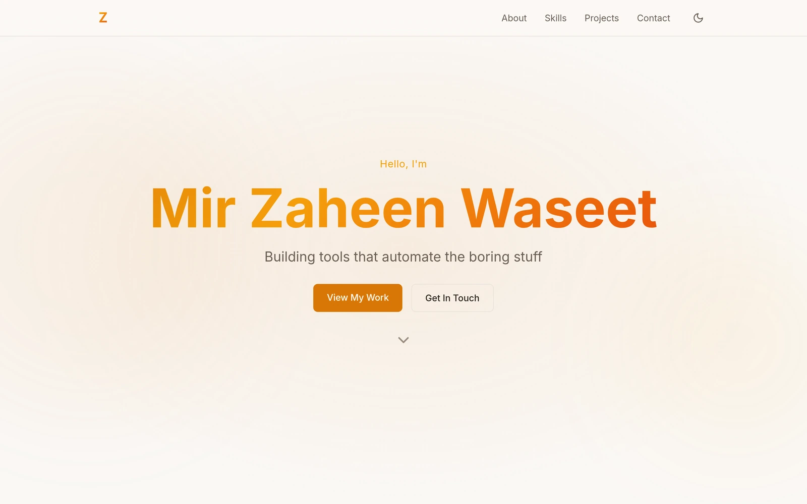

# Mir Zaheen Waseet — Portfolio

Personal portfolio site. Every section is static HTML rendered at build time; JavaScript is
reserved for the few things that genuinely need it.

**Live:** <https://zaheen4.github.io/portfolio> ·
[](https://github.com/zaheen4/portfolio/actions/workflows/deploy.yml)

<picture>
  <source media="(prefers-color-scheme: dark)" srcset="./.github/assets/hero-dark.webp" />
  <source media="(prefers-color-scheme: light)" srcset="./.github/assets/hero-light.webp" />
  
</picture>

## Features

- **Static by default** — the HTML is generated at build time. No client framework, no hydration;
  scripts only handle the theme switch, the scroll reveals and copy-to-clipboard.
- **Eleven themes, plus System** — code-editor palettes (Dracula, Nord, Monokai, Tokyo Night,
  Catppuccin, One Dark, GitHub Light, Solarized Light, …) with a crossfade on switch and a
  pre-paint script, so the correct theme is applied before the first frame.
- **Visible without JavaScript** — reveals are decoration layered on top of content that is
  already in the document, so the page still reads if scripts never run.
- **Motion as an enhancement** — anime.js letter reveals, mask sweeps and floating chips, all
  cancelled under `prefers-reduced-motion`.
- **Projects straight from GitHub** — public repositories fetched at build time and rendered as
  plain HTML cards, with committed fallback data so the build never fails on a bad API response.
- **Accessible** — keyboard operable throughout, `:focus-visible` rings, ARIA-wired widgets,
  labelled sections.
- **SEO** — Open Graph and Twitter cards with image alt text, canonical URL, JSON-LD and a
  sitemap generated at build time.
- **Responsive** — phone through widescreen, with a collapsible nav.

## Tech stack

| Layer     | Used                                                                                                    |
| --------- | ------------------------------------------------------------------------------------------------------- |
| Framework | [Astro](https://astro.build) — static output, no client framework                                       |
| Styling   | [Tailwind CSS](https://tailwindcss.com) v4 via its Vite plugin, plus CSS custom properties for theming  |
| Icons     | [astro-icon](https://github.com/natemoo-re/astro-icon) — Lucide and Simple Icons, inlined at build time |
| Animation | [anime.js](https://animejs.com)                                                                         |
| Tooling   | ESLint, Prettier, GitHub Actions                                                                        |

## Project structure

```
src/
├── components/   # One per page section, plus the theme picker, nav and back-to-top
├── data/         # Committed GitHub fallback used by the Projects section
├── layouts/      # Layout.astro — head, meta tags, theme bootstrap
├── pages/        # index.astro and 404.astro
└── styles/       # index.css — theme palettes, animations, reduced-motion rules
public/           # og-image, profile video and poster, robots.txt
.github/          # CI and deploy workflows, README screenshots
```

## Getting started

Requires Node **22.22.0** or newer and npm **9.6.5** or newer — the minimums Astro 7 enforces.

```bash
npm install
npm run dev
```

Then open <http://localhost:4321/portfolio/>.

| Script                 | What it does                                  |
| ---------------------- | --------------------------------------------- |
| `npm run dev`          | Dev server with hot reload                    |
| `npm run build`        | Build the static site into `dist/`            |
| `npm run preview`      | Serve the built `dist/` locally               |
| `npm run lint`         | Run ESLint                                    |
| `npm run format`       | Run Prettier, writing changes                 |
| `npm run format:check` | Run Prettier without writing — what CI checks |

## Projects data

The Projects section is built from the GitHub API at build time. Pass a token to stay clear of the
anonymous rate limit:

```bash
GITHUB_TOKEN=ghp_… npm run build
```

Which repositories appear, and in what order, is the `FEATURED` list at the top of
`src/components/Projects.astro`; only non-forked repositories are considered. If the request fails
— no token, rate limited, building offline — the build falls back to the snapshot in
`src/data/projects-fallback.json` rather than failing. So a build **without** a token ships
whatever is in that snapshot, which can be stale. Both workflows pass a token, so the deployed site
uses live data.

## Theming

A theme is a `[data-theme='…']` block in `src/styles/index.css` that sets `color-scheme` and a
handful of custom properties:

```css
[data-theme='dracula'] {
  color-scheme: dark;
  --bg-primary: #282a36;
  --accent: #bd93f9;
}
```

To add one, add a block there and an entry to the `themes` array in
`src/components/ThemePicker.astro`. Those two places are the entire surface — the picker, the
`<meta name="theme-color">` sync and the pre-paint script all derive from them.

The choice is stored in `localStorage` under `theme`; the value `system` defers to
`prefers-color-scheme`.

## Accessibility

- `prefers-reduced-motion: reduce` cancels every entrance animation and the animated scrolling,
  and shows the sections immediately.
- The theme picker is a real listbox: <kbd>↑</kbd>/<kbd>↓</kbd>, <kbd>Home</kbd>/<kbd>End</kbd>
  and <kbd>Esc</kbd> all work, and `aria-expanded` tracks the trigger.
- Focus styles use `:focus-visible`, so pointer users don't get rings they didn't ask for.
- Sections are labelled by their headings via `aria-labelledby`; decorative graphics are
  `aria-hidden`.

## Deployment

- **`ci.yml`** runs on pull requests (and on demand): lint, formatting check, build. Its `build`
  job is a required status check on `main`.
- **`deploy.yml`** runs on pushes to `main` (and on demand): builds and publishes `dist/` to
  GitHub Pages.

Nothing is server-rendered, so there is no runtime to operate.
